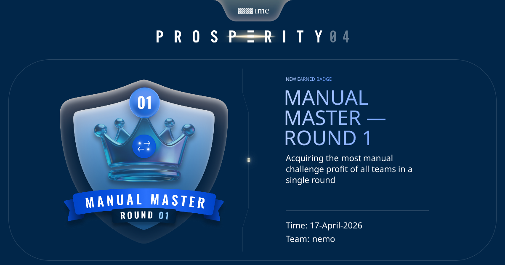
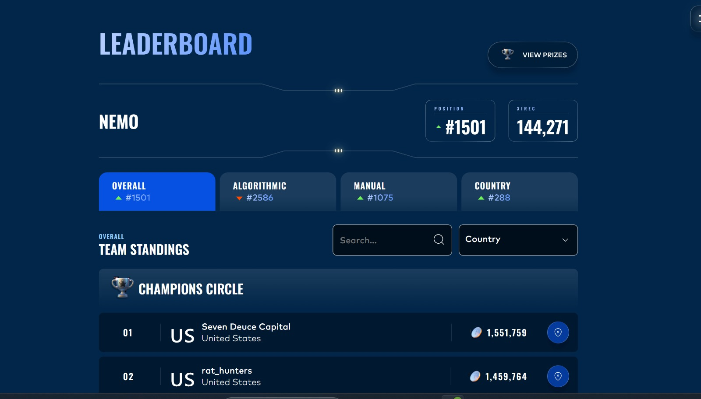
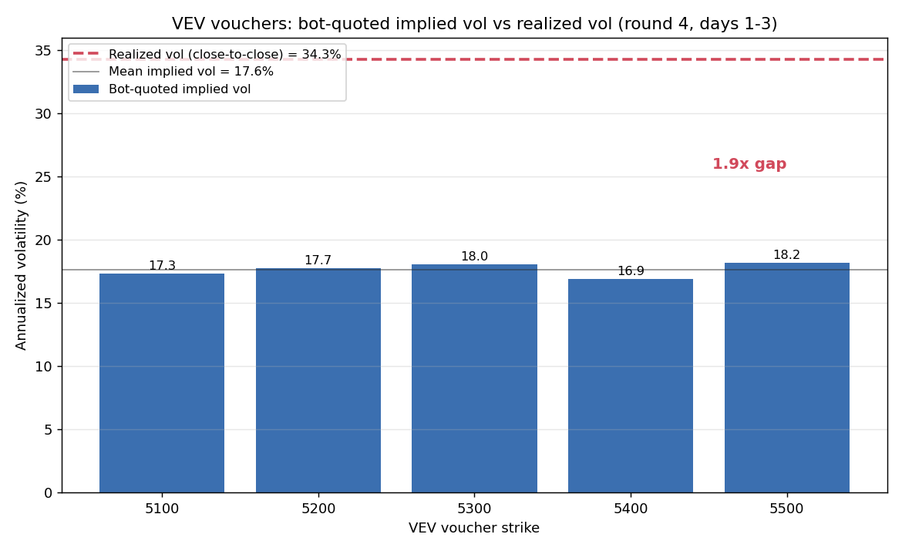

# IMC Prosperity 4 — Team NEMO

Our team's entry to IMC Prosperity 4: market-making bots, a Black-Scholes look at the option vouchers, a
counterparty-flow study and the manual game-theory rounds, all re-runnable on the real round data in [`data/`](data/).

## What it is

IMC Prosperity is a multi-round trading competition. Each round adds new products to a simulated exchange.
You submit a Python `Trader` (stdlib only) that sees the order book every tick and places orders, and you also
play a separate "manual" puzzle each round (auctions, allocation problems, option pricing). This edition had
**18,803 teams / 30,703 players from 1,549 universities in 117 countries**. I took part as one of team NEMO
from IIT Bombay.

**Where we finished:** **#1 globally in Manual Round 1** (the "Manual Master" badge for the highest
single-round manual profit), and **#1501 overall**, #1075 manual, #2586 algorithmic, #288 in India at the end.




## What I did

**A checklist before any order.** Every product went through six lenses: price shape (trend vs mean-reverting),
return distribution, volatility, autocorrelation (real structure or tick-rounding echo?), a viability ratio
(edge per trade vs the spread you have to cross), and trade flow (who is on the other side).

**Market making (rounds 1–2, [`trader.py`](trader.py)).** Fair value comes from the book, not the last trade:
the bid/ask mid, smoothed with an EMA (alpha 0.1). Per product, the strategy followed what the data showed:

| Product | What the data showed | Strategy |
|---|---|---|
| `INTARIAN_PEPPER_ROOT` | linear drift: fitted slope 0.1001 / 0.1009 / 0.1033 per observation on the three days | trend-follow when the rolling OLS slope > 0.05 |
| `ASH_COATED_OSMIUM` | stationary around ~10,000 | mean-revert to the EMA plus passive two-sided quotes |
| `HYDROGEL_PACK`, `VELVETFRUIT_EXTRACT` | tight book | passive bid+1 / ask−1 quotes |

That PEPPER slope is far too clean to be market noise. It is a hard-coded ramp, so we just rode it.

**Options (rounds 3–4).** Round 3 added `VELVETFRUIT_EXTRACT` (VEV) and ten `VEV_<strike>` call vouchers. Our
first options round lost money (−2,740) because we were guessing direction. So we built
[`black_scholes.py`](src/analysis/black_scholes.py) (pricing, Newton/bisection implied vol, close-to-close and
Parkinson realized vol), and [`vol_mispricing.py`](src/analysis/vol_mispricing.py) runs it on the round-4 quotes:

```
Mean IMPLIED vol (bot quotes, across strikes) : 0.1763  (17.6%)
  strike-to-strike IV spread (flatness check) : 0.0130  (1.3 vol pts)
REALIZED vol close-to-close (underlying)       : 0.3428  (34.3%)
RATIO realized(c2c) / implied                  :   1.94x
```

The bots quoted almost the same IV at every strike, and the underlying moved about twice as much as they
priced in. That points to buying vouchers (long vol). The bot we actually shipped,
[`trader_final_r4.py`](src/round_3_5/trader_final_r4.py), did the opposite: it built a short voucher position
once and held it for theta and end-of-day liquidation.



**Counterparty flow (round 4).** Round 4's trade logs name the bots ("Mark NN"). Round 5's logs don't.
[`counterparty.py`](src/analysis/counterparty.py) computes signed volume, edge vs mid and a 5,000-tick
forward return for each counterparty. Mark 01 (net long 4,678, +64 bps forward) and Mark 22 (net short 5,477,
−72 bps) come out as near mirror images, and Mark 38 crosses the spread hardest (+8.6 vs mid). This analysis
was descriptive and never went into the live bot.

**Stat-arb study (round 5, [`pair_trader.py`](src/round_3_5/pair_trader.py)).** This was a correlation-selected
pairs trader on the basket products. It stayed a standalone study and was never submitted.

**Manual rounds.** R1: a stale-book auction, where we bid just above the top of the queue for price priority
(global #1). R2: a research-vs-scale allocation, using calculus for the split and past competitions to guess
where the crowd would cluster. R3: a two-bid auction. R4: a chooser-option arbitrage priced with the Stulz
formula. R5: a news-driven allocation sized by tiers of news severity. Per-round notes are in
[`JOURNAL_P4.md`](JOURNAL_P4.md).

## What I learnt

- **Re-check your own claims after the event.** When I re-ran the numbers cleanly for this repo, some
  mid-competition beliefs didn't hold up. The journal records IV as 20.3%; the scripted re-run gives 17.6%. We had
  called Mark 14 "smart money", but on the forward-return measure Mark 14 is mildly *negative*. Where the two
  disagree, this README uses the script output.
- **Correlation of prices is not correlation of returns.** These are the pairs we were ready to trade
  (round 5, days 2–4):

  | Pair | Corr we recorded | Price-level corr | Return corr |
  |---|---:|---:|---:|
  | SNACKPACK_CHOCOLATE / VANILLA | −0.926 | −0.972 | −0.915 |
  | PEBBLES_S / XL | −0.834 | −0.602 | −0.491 |
  | SLEEP_POD_COTTON / POLYESTER | +0.875 | +0.740 | −0.008 |
  | MICROCHIP_OVAL / TRIANGLE | +0.870 | +0.360 | +0.002 |

  Only SNACKPACK (and weakly PEBBLES) co-move in returns. The rest were two trending paths that looked
  related. That is the reason the pairs module stayed on the bench.
- **Analysis and execution can drift apart.** The vol study said long vol, and we shipped short vol. I want the
  next bot to come straight out of the analysis.
- **Pick estimators that fit the data.** The Parkinson (high–low) estimator gives ~263% on this tick data,
  because bid-ask bounce dominates short bars. Close-to-close is the credible number.
- **"Clean" numbers are tells.** An exact slope or a flat IV surface is a hard-coded bot parameter, and that's
  the edge.
- **Commit to the math in manual rounds.** Every time we moved off a computed optimum toward a number that
  "felt safer", it cost us.

## Repo structure

```text
├── trader.py                 # final submitted market-making bot (stdlib only)
├── datamodel.py              # local copy of IMC's data model
├── JOURNAL_P4.md             # round-by-round competition journal
├── STRATEGY_PLAYBOOK.md      # how we turned analysis into strategy parameters
├── data/round1..round5/      # real price + trade CSVs for each round
├── plots/                    # leaderboard screenshots + generated figures
└── src/
    ├── round_1_2/            # simple_trader.py, trader_final_r2.py
    ├── round_3_5/            # pair_trader.py (study), trader_final_r4.py (shipped voucher bot)
    └── analysis/             # black_scholes.py, vol_mispricing.py, counterparty.py,
                              # analyze_groups.py, visualise.py, explore.ipynb
```

## How to run

```bash
pip install -r requirements.txt               # numpy, pandas, matplotlib, scipy (analysis only)

python src/analysis/black_scholes.py          # BS self-test (price -> IV round trip)
python src/analysis/vol_mispricing.py         # implied vs realized vol -> plots/iv_vs_realized.png
python src/analysis/counterparty.py           # counterparty table -> plots/counterparty_classification.png
```

The scripts only read the CSVs in `data/`. `trader.py` is the file uploaded to the Prosperity platform.
It imports `datamodel.py` and needs nothing outside the standard library.
