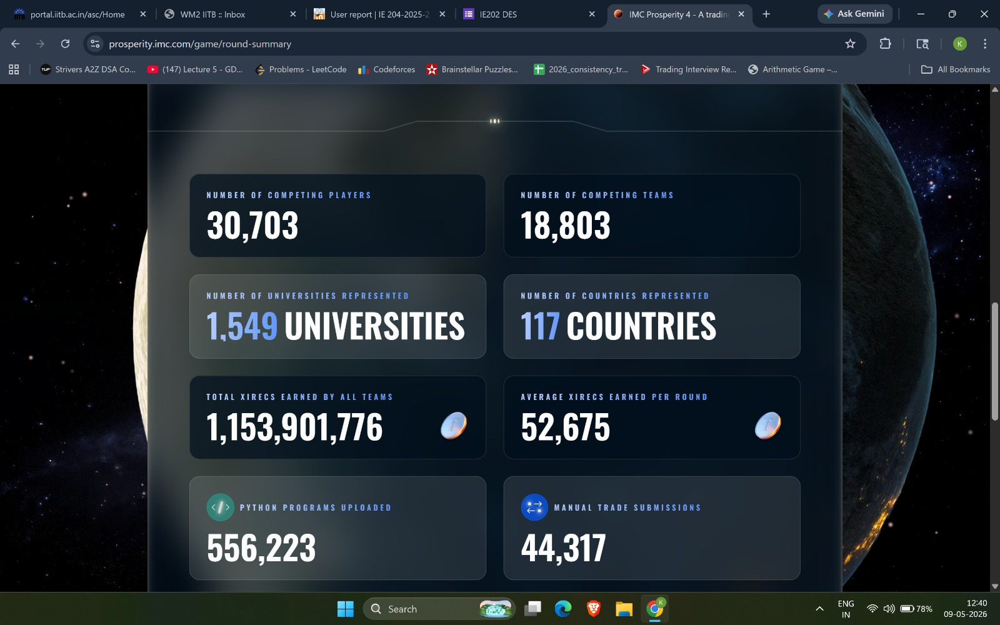
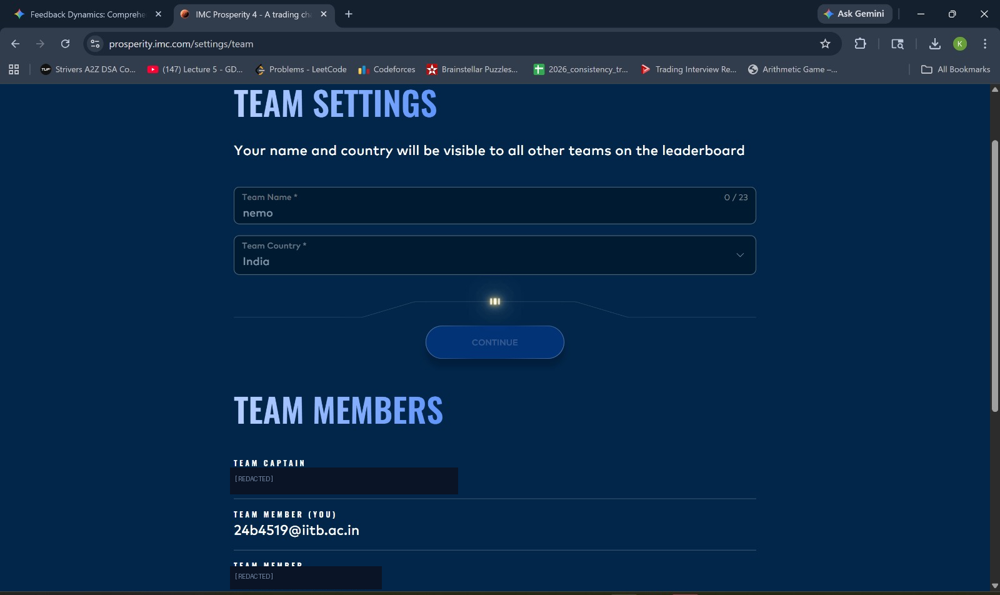
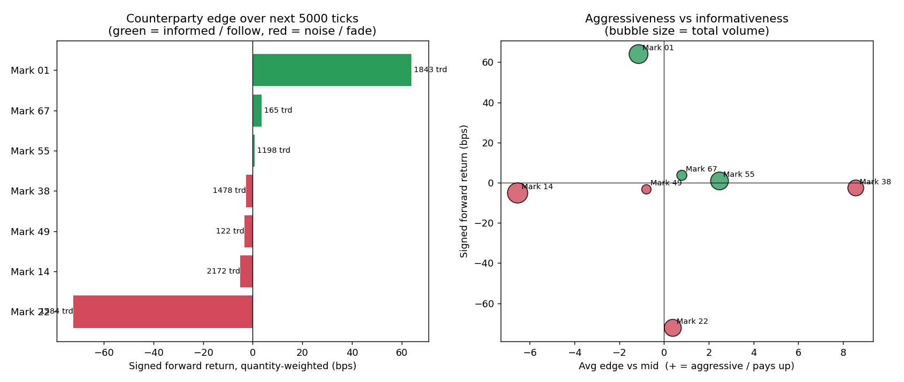

# IMC Prosperity 4 — Team NEMO

A trading-competition retrospective: market making, a statistical-arbitrage
study, a Black-Scholes volatility analysis, and a counterparty-flow classifier —
all built on the real round data in [`data/`](data/) so anyone can re-run the
numbers below.

**Headline result: Manual Round 1 — global rank #1** ("Manual Master" badge:
most manual-challenge profit of *any* team in a single round). Final standings:
**#1501 overall**, #1075 manual, #2586 algorithmic, **country #288 (India)** —
out of **18,803 teams / 30,703 players / 1,549 universities / 117 countries**.


*Manual Master — Round 1: awarded to the team with the highest single-round
manual profit. Team `nemo`, 17-April-2026.*


*Final standings for NEMO: overall #1501, manual #1075, algorithmic #2586,
country #288, 144,271 XIRECs.*


*Scale of the field: 30,703 players, 18,803 teams, 1,549 universities,
117 countries.*


*Team NEMO (IIT Bombay). Personal emails redacted; roll `24b4519` retained.*

> Everything numeric in this README is produced by the scripts in
> [`src/analysis/`](src/analysis/) reading [`data/`](data/). Where a claim we
> *made during the competition* is not fully supported by a clean re-run of the
> data, this document says so rather than smoothing it over.

---

## The 6-lens analytical framework

Every product went through the same checklist before we wrote a single order:

1. **Price shape** — trend vs mean-reverting vs pinned (linear-regression slope).
2. **Distribution** — return histogram, fat tails, jumps.
3. **Volatility** — realized vol, and for options, implied vol.
4. **Autocorrelation** — is there tradeable structure, or just tick-rounding echo?
5. **Viability ratio** — expected edge per trade vs the spread we must cross.
6. **Trade flow** — who is on the other side, and does the market move their way?

The sections below are those lenses applied to the four instrument families.

---

## Market making

The submitted bot ([`trader.py`](trader.py)) is a stdlib-only market maker. Fair
value is anchored on the order book rather than the last trade:

- **Wall-mid** — midpoint of best bid and best ask (`get_mid`).
- **VWAP-mid** — best bid/ask weighted by their sizes (`get_vwmp` in
  [`src/round_3_5/pair_trader.py`](src/round_3_5/pair_trader.py)), a steadier
  anchor when the top of book is thin.
- An EMA (alpha 0.1) of the mid smooths the fair value for the mean-reverting
  products.

Per-product logic follows the price shape we measured on the round-1 data:

| Product | Price shape (measured) | Strategy |
|---|---|---|
| `INTARIAN_PEPPER_ROOT` | **linear drift, slope ≈ 0.100 / observation every day** (a suspiciously clean +0.001 per timestamp) | trend-follow: take the ask when the rolling OLS slope > 0.05 |
| `ASH_COATED_OSMIUM` | **stationary**, oscillates around ~10,000 (slope ≈ 0.0006) | mean-revert to EMA + passive two-sided quotes |
| `HYDROGEL_PACK`, `VELVETFRUIT_EXTRACT` | tight book | passive bid+1 / ask−1 quoting |

The PEPPER drift is the textbook "clean-number tell": across all three sample
days the fitted slope came out **0.1001, 0.1009, 0.1033 per observation** — a
hardcoded +1000/day linear ramp, not market noise, so we simply rode it.
(Reproduce: the slope check is in the market-making notes; the raw series is in
`data/round1/`.)

---

## Statistical arbitrage (standalone study)

[`src/round_3_5/pair_trader.py`](src/round_3_5/pair_trader.py) is a
correlation-selected pairs trader. **Be clear: this was a standalone research
module — it was never part of the final submitted bot.** It trades ratio/spread
reversion on pairs we picked from a correlation sweep of the round-5 basket
products.

Re-running the correlations on the real round-5 data (`data/round5/`, days 2–4)
tells an honest, mixed story:

| Pair | Corr we recorded | Real corr (price level) | Real corr (returns) |
|---|---:|---:|---:|
| `SNACKPACK_CHOCOLATE` / `SNACKPACK_VANILLA` | −0.926 | **−0.972** | **−0.915** |
| `PEBBLES_S` / `PEBBLES_XL` | −0.834 | −0.602 | −0.491 |
| `SLEEP_POD_COTTON` / `SLEEP_POD_POLYESTER` | +0.875 | +0.740 | −0.008 |
| `MICROCHIP_OVAL` / `MICROCHIP_TRIANGLE` | +0.870 | +0.360 | +0.002 |
| `UV_VISOR_AMBER` / `UV_VISOR_MAGENTA` | −0.867 | −0.330 | +0.006 |
| `ROBOT_MOPPING` / `ROBOT_IRONING` | −0.815 | −0.250 | −0.001 |

The lesson is right there in the last column: only **SNACKPACK** (and weakly
**PEBBLES**) survive as a *return* co-movement you could actually hedge on. The
others are level co-trending — high correlation of the price *paths* that
collapses to ~0 once you difference into returns. Several of the pairs we were
prepared to trade were correlation mirages; this is why the module stayed on the
bench.

---

## Options & volatility

The round-3/4 board introduced `VELVETFRUIT_EXTRACT` (VEV) and ten
`VEV_<strike>` vouchers — European calls on VELVETFRUIT_EXTRACT. Our first
options run lost money guessing direction, which pushed us to price them
properly.

### The Black-Scholes model

[`src/analysis/black_scholes.py`](src/analysis/black_scholes.py) implements
`d1`/`d2`, `bs_call_price`, `implied_vol` (Newton–Raphson with a bisection
fallback), `realized_vol` (close-to-close, annualized) and `parkinson_vol`
(high–low). [`src/analysis/vol_mispricing.py`](src/analysis/vol_mispricing.py)
loads the real round-4 voucher + underlying files, backs out the vol the
market-maker bots were quoting per strike, and compares it to what the
underlying actually did over the same window.

Assumptions (documented so the numbers reproduce): European call, r = 0,
time-to-expiry T = 7 trading days = 7/250 yr, annualization = 10,000
samples/day × 250 days. IV scales ≈ 1/√T, so its *level* depends on T, but the
strike-to-strike flatness and the direction of the gap do not.

### What the data actually says

```
Per-strike implied volatility (round 4, days 1-3, real quotes):
   strike  moneyness  mean_mid  impl_vol     std       n
     5100      1.029    160.86    0.1734  0.0147   30000
     5200      1.009     88.99    0.1775  0.0154   30000
     5300      0.990     41.18    0.1803  0.0151   30000
     5400      0.972     12.63    0.1687  0.0129   30000
     5500      0.954      4.71    0.1817  0.0165   30000

Mean IMPLIED vol (bot quotes, across strikes) : 0.1763  (17.6%)
  strike-to-strike IV spread (flatness check) : 0.0130  (1.3 vol pts)
REALIZED vol close-to-close (underlying)       : 0.3428  (34.3%)   <- headline
RATIO realized(c2c) / implied                  :   1.94x
Verdict: vouchers were UNDERPRICED (realized > implied -> long-vol edge)
```


Two findings, both real:

- **The bots' implied vol was flat at ~17.6%** across strikes (a 1.3 vol-point
  spread) — a near-constant IV is an algorithmic tell, exactly like PEPPER's
  clean slope.
- **The underlying realized ~34.3%**, so vouchers were structurally
  **underpriced by ~1.9×**. That points to a **long-volatility** edge (buy
  cheap gamma).

Two honest caveats:

- We do **not** use the Parkinson estimator for the headline. On this tick data
  it explodes to ~263% because high/low over short bars is dominated by bid-ask
  bounce and tick rounding — a microstructure artifact, not vol. Close-to-close
  is the credible number.
- **The bot we actually shipped went the *other* way.**
  [`src/round_3_5/trader_final_r4.py`](src/round_3_5/trader_final_r4.py) sells
  vouchers to build a short position and holds for **theta / end-of-day
  liquidation** — a *short-vol* strategy. So this Black-Scholes study is best
  read as the analysis that *identified* the edge (long vol), while the live bot
  harvested short-vol theta instead. The two disagree, and that gap is one of
  the more useful things we took away from the round.

---

## Counterparty flow analysis

Round 4 is the one round whose trade logs reveal counterparty IDs (the "Mark NN"
bots); **round 5's logs have blank buyer/seller fields**, so this analysis is
necessarily built on `data/round4/`.
[`src/analysis/counterparty.py`](src/analysis/counterparty.py) takes both sides
of every trade, and per counterparty computes signed volume, average edge vs mid
(aggressive vs passive), and a signed forward return over the next 5,000 ticks
(did the market move their way?), plus a win rate.

```
Ranked by forward return (quantity-weighted, signed by their side):
  counterparty  n_trd  tot_qty signed_vol edge_vs_mid fwd_ret_bps win_rate  type
  Mark 01        1843     7428       4678      -1.136       64.02    0.265  INFORMED
  Mark 67         165     1510       1510       0.797        3.66    0.588  INFORMED
  Mark 55        1198     6551        -43       2.482        0.88    0.515  INFORMED
  Mark 38        1478     5000        -14       8.572       -2.60    0.472  noise
  Mark 49         122     1186       -956      -0.787       -3.30    0.385  noise
  Mark 14        2172     8718        302      -6.541       -5.10    0.481  noise
  Mark 22        1584     5889      -5477       0.394      -72.25    0.188  noise
```



Read honestly, this is **descriptive flow analysis, and it did not feed the live
bot.** The two extremes — **Mark 01** (net long 4,678, +64 bps forward) and
**Mark 22** (net short 5,477, −72 bps forward) — are mostly mirror images of
each other: they are the two big directional players, and the underlying drifted
up over the sample, so the buyer's flow looks "smart" and the seller's looks
"dumb." Note the tension in the table: Mark 01's *magnitude* is huge but its
*win rate* is only 27% — a handful of large favorable moves, not consistency.
The only counterparties clearing 50% win rate are the smaller **Mark 67** and
**Mark 55**.

Two corrections to what we believed mid-competition: the standout aggressor by
edge-paid was **Mark 38** (pays +8.6 vs mid, i.e. crosses the spread hardest),
not the players we'd have guessed; and our old note that "Mark 14 = smart money"
does **not** hold up — on this measure Mark 14 comes out mildly *negative*. The
real signal, such as it is, is Mark 01 (follow) vs Mark 22 (fade).

---

## Manual rounds — game theory & math

The manual challenges are where NEMO scored best (Round 1 = global #1).

- **Round 1 (global #1):** the "stale-book auction." We bid just above the top
  of the queue to guarantee price priority while still clearing at a very
  favorable price — enough for the highest single-round manual profit of any
  team.
- **Round 2:** a resource-allocation problem. We used calculus to derive the
  optimal research-to-scale split and a Bayesian read of prior competitions to
  predict where the crowd would cluster, landing near the theoretical maximum.
- **Round 3:** a two-bid auction, where we found human crowds overshoot the
  Nash equilibrium more aggressively than the textbook predicts.
- **Round 4:** a risk-free chooser-option arbitrage priced with the Stulz
  formula; the lesson was that a closed-form expectation is a safer anchor than
  a high-variance Monte-Carlo run.
- **Round 5:** a news-driven portfolio allocation, sized with a tiered rule
  keyed to the severity of each news event.

Recurring lesson across the manual rounds: drifting off a computed optimum
toward a "feels safer" number consistently cost us money.

---

## Repository structure

```text
├── datamodel.py                 # Official IMC data model (local copy)
├── trader.py                    # Final submitted market-making bot
├── requirements.txt             # numpy / pandas / matplotlib / scipy (analysis only)
├── data/                        # Real round price + trade CSVs (rounds 1-5)
├── plots/                       # Result screenshots + generated figures
└── src/
    ├── round_1_2/               # simple_trader.py, trader_final_r2.py
    ├── round_3_5/
    │   ├── pair_trader.py        # standalone stat-arb study
    │   └── trader_final_r4.py    # shipped short-vol / theta voucher bot
    └── analysis/
        ├── black_scholes.py      # BS pricing + implied/realized vol toolkit
        ├── vol_mispricing.py     # implied-vs-realized voucher analysis
        ├── counterparty.py       # counterparty flow classifier
        ├── analyze_groups.py     # EDA helpers
        └── visualise.py          # plotting helpers
```

## How to run the analysis

```bash
pip install -r requirements.txt

# Black-Scholes self-test (price round-trip)
python src/analysis/black_scholes.py

# Voucher implied-vs-realized vol -> writes plots/iv_vs_realized.png
python src/analysis/vol_mispricing.py

# Counterparty flow classifier -> writes plots/counterparty_classification.png
python src/analysis/counterparty.py
```

Each script reads only the CSVs in `data/` and prints the numbers reproduced
above.

---
*Team NEMO — IIT Bombay.*
